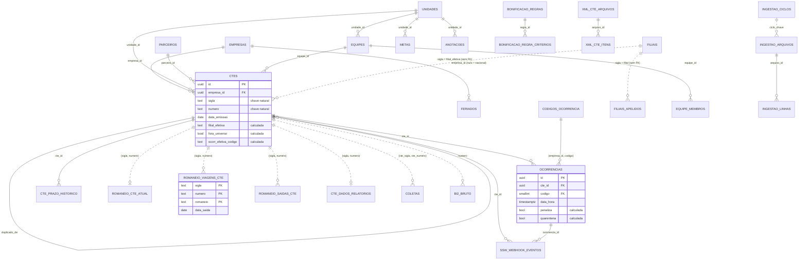

# Modelo de dados do domínio (schema `erp`)

Schema de domínio do ERP SSW: o que o sistema atual guarda em `public` e que alguma tela, rota
pública ou job usa hoje, remodelado para o banco que só guarda dados. Código em
`apps/api/src/db/schema/dominio/*.ts` (um arquivo por agregado). Identidade, plataforma e
auditoria (empresas, usuários, sessões, cargos, departamentos, telas, módulos, integrações,
configurações, auditoria) são da fundação e não estão aqui.

Arquivos de apoio:

- `de-para.md`: mapa `public.<tabela>.<coluna>` → `erp.<tabela>.<coluna>` para o migrador.
- `ddl-dominio-previa.sql`: prévia do DDL do schema de domínio, feita para revisão (histórica; o
  DDL que vale está em `apps/api/migracoes/`).
- `ddl-complementar.sql`: índices com INCLUDE e `fillfactor`, que a prévia não trazia.

## Princípios

1. **Banco só guarda dados.** Nenhuma função, gatilho, view, view materializada, extensão ou cron.
   O que era gatilho virou coluna gravada pelo backend (marcada no código com
   `// calculada pelo backend: <regra>. origem: <função atual>`); o que era matview virou
   projeção mantida pelo worker; o que era fila/lease no banco virou estado do BullMQ.
2. **Toda tabela tem `empresa_id uuid not null`** com FK `on delete restrict` para `empresas`,
   e RLS por empresa (`empresa_id = app.empresa_id`). Exceção única: `feriados`, onde
   `empresa_id` nulo é feriado nacional.
3. **CT-e é empresa + sigla + número.** O número sozinho se repete entre séries
   (CAP033214 ≠ CAS033214) e casar só por ele já misturou CT-e no sistema atual. Toda projeção
   e todo índice de busca usam a chave natural completa. Exceção consciente: `bi2_bruto`, porque o
   BI2 não traz a sigla de forma confiável.
4. **Tipos de negócio:** `date` para dia de negócio (emissão, previsão, conclusão, saída — dia em
   America/Sao_Paulo); `timestamptz` para instantes; `numeric(14,2)` para dinheiro;
   `numeric(12,3)` para peso; enum do Postgres onde o domínio é fechado e estável; `text` + `check`
   onde a lista pode crescer.
5. **`criado_em` / `atualizado_em`** em toda tabela mutável; `atualizado_em` é gravado pelo backend
   no UPDATE (sem gatilho).
6. **Nada morto:** só entrou tabela/coluna com leitor vivo (tela, rota pública, job ou regra de
   escrita). A lista do que ficou de fora está no fim deste documento e em `de-para.md`.

## Diagrama

Linha cheia = FK. Linha pontilhada = junção pela chave natural, sem FK (o relatório pode citar
CT-e que ainda não existe na base ou está antes da trava de emissão mínima).

## Agregados

### CT-e (`ctes.ts`)

`ctes` é o antigo `ctrcs` (252 mil linhas, a tabela central). Renomeado para o termo que a tela
usa. Colunas mantidas com o nome atual, exceto: `numero_ctrc` → `numero` (só dígitos, sem o
sufixo `/sigla` dos CT-e "estacionados"), `sigla_ctrc` → `sigla` (agora `not null`),
`chave_cte` → `chave`, `created_at/updated_at` → `criado_em/atualizado_em`.

Colunas novas, todas calculadas pelo backend para tirar expressão repetida das consultas:

| Coluna                     | Regra                                              | Por quê                                                               |
| -------------------------- | -------------------------------------------------- | --------------------------------------------------------------------- |
| `filial_efetiva`           | `coalesce(unidade_destino, unidade_atual, filial)` | É o filtro de universo e de filial de ~45 RPCs; vira chave de índice. |
| `pagador_cnpj_digitos`     | dígitos de `pagador_cnpj`                          | Filtro de pagador indexável sem índice de expressão.                  |
| `ocorr_efetiva_codigo_num` | `norm_codigo_ocorr(ocorr_efetiva_codigo)`          | Filtro de código indexável.                                           |

Colunas que eram gatilho e continuam gravadas (regra no comentário de cada uma): `fora_universo`,
`cancelado_mesmo_dia`, `ocorr_efetiva_*`, `data_conclusao_efetiva`, `prazo_padrao_dias/data`,
`unidade_cidade/uf`, `data_embarque`, `status_atual`, `campos_ssw`. Também é regra de escrita (não
coluna) a trava de emissão mínima (`configuracoes.ctrc_data_minima_emissao`: CT-e mais antigo não
entra) e a emissão puxada pela ocorrência 80 (`sync_data_emissao_from_ocorrencia_80`).

`cte_prazo_historico`: cada troca de previsão (antes gatilho `_trg_ctrcs_log_prazo`). Hoje nada
lê esta tabela além de cargas de correção pontuais (ela já restaurou 9,3 mil previsões em 02/10);
fica por ser o único registro de previsões anteriores.

### Ocorrências (`ocorrencias.ts`) e catálogo (`codigos-ocorrencia.ts`)

`ocorrencias` (1,5 mi): FK composta `(empresa_id, codigo)` → `codigos_ocorrencia`. `penaliza` e
`responsavel` são cópia do catálogo (gravadas ao inserir e regravadas em massa quando o catálogo
muda — antes `fill_ocorrencia_penaliza` e `propagate_codigo_changes`). `quarentena` é a regra de
`guard_data_ocorrencia`. Gravar/apagar ocorrência recalcula as derivadas do CT-e na mesma
transação (6 gatilhos antes). `codigo` virou `smallint` (0–99).

`codigos_ocorrencia` por empresa; a empresa nova recebe cópia do catálogo da empresa modelo
pelo caso de uso de criar empresa (antes `_trg_empresas_semear`).

### Filiais e unidades (`filiais.ts`)

`filiais` (catálogo SSW por sigla, com `propria` = universo das telas), `filiais_apelidos`
(cidade → sigla) e `unidades` (unidades operacionais: escopo de usuário, equipe, meta). São
conceitos diferentes no sistema atual (23 filiais × 7 unidades) e continuam separados.

### Parceiros e prazos (`parceiros.ts`)

`parceiros` e `prazos_configurados` (regra por unidade, parceiro ou transbordo). Não há tabela de
pagadores: pagador é atributo do CT-e.

### Calendário (`feriados.ts`, `anotacoes.ts`, `metas.ts`)

`feriados` com `empresa_id` nulo = nacional. RLS própria: a empresa lê nacionais + os dela e grava
só os dela; nacional só em sessão de Plataforma. `anotacoes` (histórico do dia) e `metas`.

### Equipes, ranking e bonificação (`equipes.ts`, `bonificacao.ts`)

`equipes` + `equipe_membros`. O link público do ranking guarda só o SHA-256 do token
(`token_publico_hash`): a URL não muda, mas o banco vazado não entrega links. A rota pública
resolve o token sem empresa na sessão pela política `equipes_token_publico_select`
(`app.token_publico_hash`), depois põe `app.empresa_id` da equipe.

Bonificação: regras e critérios (Ranking > Regras) e parâmetros, faltas e códigos (apuração do
ponto). A apuração é calculada na consulta. **Ahgora não tem tabela**: as horas extras vêm da API
na hora da apuração e a credencial é `empresa_integracoes` (fundação).

### Coletas (`coletas.ts`)

Chave `(empresa, unidade, número)`. `etapa` gravada (depende só da situação); `status_prazo`
calculado na consulta (depende de "agora").

### Projeções (`projecoes.ts`)

Tabelas de leitura mantidas pelo worker. Substituem as 5 matviews e as views de romaneio:

| Projeção               | Chave                              | Substitui                                                                                                                | Quem lê                                                                                                          |
| ---------------------- | ---------------------------------- | ------------------------------------------------------------------------------------------------------------------------ | ---------------------------------------------------------------------------------------------------------------- |
| `romaneio_viagens_cte` | empresa, sigla, número, romaneio   | `mv_romaneio_viagem_ctrc`                                                                                                | Romaneio (todas as abas), performance por carro/ajudante/motorista, prejuízo, opções de placa/motorista          |
| `romaneio_saidas_cte`  | empresa, sigla, número, data_saida | `romaneio_saida_ctrc` (gatilho) + view `mv_ctrc_saida_romaneio`                                                          | filtro "saída para entrega", performance por carro/ajudante                                                      |
| `romaneio_cte_atual`   | empresa, sigla, número             | `mv_romaneio_036_ctrc`, `mv_romaneio_ctrc_motorista` e as views `romaneio_036_ctrc`, `romaneio_ctrc_motorista(_v2/_306)` | Listagem detalhada, Romaneio (Hoje/detalhe), motivos de não entrega, apuração de bônus, aplicação do 036 no CT-e |
| `cte_dados_relatorios` | empresa, sigla, número             | `mv_ctrc_staging_enriquecido` + view                                                                                     | detalhe do Romaneio                                                                                              |
| `romaneio_conferente_cte` | empresa, sigla, número | `_ocorrencias_conferente_romaneio` e `ocorrencias_conferentes_opcoes` (liam a staging 036) | Ocorrências (filtro e colunas Conferente/Romaneio, seletor de conferentes) |

`mv_romaneio_placa_motorista_dia` não tem leitor (só o refresh) e não vira projeção.
`vw_performance_dia` (Dashboard) e `vw_coletas` viram consulta do backend; `v_ssw_*` não têm
leitor.

A retenção das linhas de relatório não apaga projeção: a projeção é o estado acumulado.

### Ingestão (`ingestao.ts`)

As 6 stagings largas (≈ 4 GB) viram `ingestao_linhas`: uma linha por linha de relatório, com
`relatorio`, `hash` (dedupe), `sigla`/`numero` do CT-e, `dados` (jsonb validado por zod no
worker) e `aplicado_em`. Os 5 `staging_*_erros_parsing` viram `ingestao_erros`.
`ssw_relatorio_arquivos` → `ingestao_arquivos`; `ssw_ciclo_importacao` → `ingestao_ciclos`;
`ssw_relatorio_tipos` → `ingestao_relatorios_esperados` (agora por empresa, porque as unidades
esperadas são da empresa); `ssw_aplicacao_log` → `ingestao_aplicacoes`.

### XML CT-e, BI2 e SSW (`xml-cte.ts`, `bi2.ts`, `ssw.ts`)

`xml_cte_arquivos/itens/orfaos` + `xml_ftp_sincronizacoes`; `bi2_bruto` (último payload por CT-e
por relatório, upsert) + `bi2_sincronizacoes`; `ssw_webhook_eventos` + `ssw_sincronizacoes`.
Credenciais/configuração do SSW (`ssw_config`) vão para `empresa_integracoes` da fundação.

## Retenção (job diário do worker)

| Tabela                                                                | Retenção               | Critério                                                |
| --------------------------------------------------------------------- | ---------------------- | ------------------------------------------------------- |
| `ingestao_linhas`                                                     | 60 dias                | `aplicado_em` (não aplicada não expira)                 |
| `ingestao_erros`                                                      | 30 dias                | `criado_em`                                             |
| `ingestao_arquivos`, `ingestao_ciclos`, `ingestao_aplicacoes`         | 180 dias               | `criado_em` / `iniciado_em`                             |
| `xml_cte_arquivos` (+ itens em cascata)                               | 180 dias               | `criado_em`                                             |
| `xml_cte_orfaos` casados/expirados                                    | 30 dias                | `atualizado_em`                                         |
| `xml_ftp_sincronizacoes`, `ssw_sincronizacoes`, `ssw_webhook_eventos` | 90 dias                | instante da execução / recebimento                      |
| `bi2_sincronizacoes`                                                  | 400 dias               | `iniciado_em` (cobre reprocessamento retroativo do ano) |
| `bi2_bruto`                                                           | sem retenção por tempo | upsert: uma linha por CT-e por relatório                |

Dado de negócio (`ctes`, `ocorrencias`, projeções, cadastros) não tem retenção.

## Índices: os que importam e por quê

Todos começam por `empresa_id` (RLS + multiempresa; a empresa é sempre o primeiro filtro).

- **`ctes_universo_emissao_cobre_idx`** (`ddl-complementar.sql`): `(empresa_id, data_emissao,
filial_efetiva) INCLUDE (...) WHERE NOT fora_universo`. É a consulta-base de Performance,
  Listagem, Ocorrências, Ranking e Romaneio: período de emissão dentro do universo. A filial
  efetiva na chave resolve o "filial própria" no índice; o INCLUDE cobre as colunas das
  agregações (índice-only scan sobre 250 mil CT-e). Parcial em `NOT fora_universo` porque nenhuma
  tela olha CT-e fora do universo.
- **`ctes_universo_{entrega,previsao,conclusao,embarque}_idx`**: o seletor de "base de data" das
  telas (emissão / entrega / previsão / conclusão / embarque). Parciais em `not null` porque CT-e
  aberto não tem entrega nem conclusão.
- **`ctes_universo_abertos_idx`**: CT-e sem entrega (alertas, previstos, sem movimento, travados);
  são minoria, o índice parcial é pequeno.
- **`ctes_universo_filial_emissao_idx`**, **`_pagador_idx`**, **`_codigo_idx`**,
  **`ctes_unidade_emissao_idx`**, **`ctes_parceiro_emissao_idx`**: filtros de tela mais
  seletivos que o período (filial, pagador, código da ocorrência efetiva, unidade, parceiro),
  com o período em segundo para range scan.
- **`ctes_empresa_sigla_numero_uq`**: identidade; também é a junção com as projeções.
  **`ctes_numero_idx`**: busca pelo número sem sigla (caixa de busca e URL `/ctrc/<numero>`).
- **`ocorrencias_cte_codigo_data_uq`**: dedupe do evento e acesso "ocorrências do CT-e" /
  "CT-e tem código X" (substitui 6 índices parciais por código do sistema atual).
- **`ocorrencias_data_cobre_idx`** (`ddl-complementar.sql`) e **`ocorrencias_codigo_data_idx`**:
  painel de Ocorrências por período da ocorrência, com e sem código.
- Projeções: `(empresa_id, data_saida)` e `(empresa_id, placa|motorista_normalizado, data_saida)`
  em `romaneio_viagens_cte` (período e filtros do Romaneio).

Removidos do sistema atual: índice trigram em `cidade_destino` (exige a extensão `pg_trgm`,
proibida; o filtro de destino roda sobre o período já filtrado) e os índices de expressão sobre
`regexp_replace(...)` (viraram colunas calculadas).

## Segurança (RLS)

RLS ligado nas 38 tabelas. Padrão (`politicasDaEmpresa`, da fundação): SELECT/INSERT/UPDATE/DELETE
só com `empresa_id = nullif(current_setting('app.empresa_id', true), '')::uuid`. Sem contexto,
nenhuma linha. Exceções declaradas:

- `feriados`: lê nacionais (`empresa_id is null`) + os da empresa; grava nacional só com
  `app.plataforma = 'on'`.
- `equipes`: política extra de SELECT por `app.token_publico_hash` para a rota pública do ranking.

## Descartado (com motivo)

| Objeto atual                                                                 | Motivo                                                                                                                                                                                                                                                                                                                                                                                                                                                                                               |
| ---------------------------------------------------------------------------- | ---------------------------------------------------------------------------------------------------------------------------------------------------------------------------------------------------------------------------------------------------------------------------------------------------------------------------------------------------------------------------------------------------------------------------------------------------------------------------------------------------- |
| `bonificacao_calculo`                                                        | Só `fechar_periodo_bonificacao` grava, e a server function `fecharPeriodo` não é chamada por nenhuma tela. A apuração é calculada na consulta.                                                                                                                                                                                                                                                                                                                                                       |
| `prazo_padrao_cidade`                                                        | Marcada OBSOLETA desde 09/10/2026; só funções sem chamador a leem.                                                                                                                                                                                                                                                                                                                                                                                                                                   |
| `bi2_viagens`                                                                | Só a ingestão 0220 grava; o único leitor é a view `romaneio_placa_motorista`, sem uso. O 0220 está desligado.                                                                                                                                                                                                                                                                                                                                                                                        |
| `sync_state`                                                                 | A tela Ingestão só usa o log; "última atividade do webhook" sai de `ssw_webhook_eventos`; hot/warm/cold/backfill ficaram sem uso com a API/enriquecimento SSW desativados.                                                                                                                                                                                                                                                                                                                           |
| `job_lease`, `ssw_aplicacao_fila`, `ssw_fila_controle`, `ftp_sync_progresso` | Estado de job: vira BullMQ/Redis (lease, fila, progresso).                                                                                                                                                                                                                                                                                                                                                                                                                                           |
| `ssw_config`                                                                 | Credencial/configuração: vai para `empresa_integracoes` (fundação).                                                                                                                                                                                                                                                                                                                                                                                                                                  |
| `foto_referencia`                                                            | Artefato de verificação da migração; nenhum uso.                                                                                                                                                                                                                                                                                                                                                                                                                                                     |
| `staging_038/455/455_csv/930/306/036` e `*_erros_parsing`                    | Substituídas por `ingestao_linhas` e `ingestao_erros` (genéricas, com retenção).                                                                                                                                                                                                                                                                                                                                                                                                                     |
| Matviews/views                                                               | Viram projeções ou consulta do backend (ver Projeções). `mv_romaneio_placa_motorista_dia`, `romaneio_placa_motorista`, `v_ssw_*`, `vw_performance_dia` sem projeção.                                                                                                                                                                                                                                                                                                                                 |
| Colunas de `ctrcs` sem leitor                                                | `cnpj_transportadora`, `endereco/telefone/email/cep/cidade/uf_remetente`, `motivo_cancelamento`, `valor_nf`, `situacao_bi2`, `cte_complementar_de`, `tomador_nome/cnpj`, `chave_cte_anterior`, `data_entrega_negociada`, `enriquecimento_tentado_em`, `prazo_ssw_indisponivel`, `romaneio_numero`, `romaneio_situacao`, `ajudante_2_nome`, `ajudante_3_nome`: só gravadas (parser XML/BI2, enriquecimento SSW desativado ou aplicação do 036), nenhuma tela, exportação ou regra lê. |
| Colunas de `ocorrencias` sem leitor                                          | `payload_bruto` (só a regra do trackingdanfe, desativado), `latitude`, `longitude`, `nome_recebedor`, `doc_recebedor`, `quarentena_motivo`.                                                                                                                                                                                                                                                                                                                                                          |
| Colunas de `codigos_ocorrencia` sem leitor                                   | `codigo_ssw`, `descricao_ssw`, `paga_comissao_recepcao`, `paga_agregado_entrega`, `cobrar_reentrega`, `cobrar_estadia`, `informa_cliente`, `responsabilidade_unidade_origem`, `responsabilidade_unidade_anterior` (gravadas pela sincronização do catálogo, nunca lidas).                                                                                                                                                                                                                            |
| Outras colunas sem leitor                                                    | `membros_equipe.data_entrada`, `membros_equipe.nome_normalizado` (coluna gerada por função), `regras_bonificacao.criada_por`, `prazos_configurados.created_by`, `xml_cte_arquivos_processados.enviado_por`, `sync_log.periodo_*/ssw_calls/ssw_falhas`, `ssw_webhook_eventos.created_at` (duplica `recebido_em`).                                                                                                                                                                                     |
